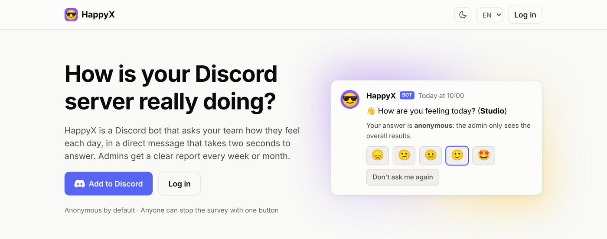
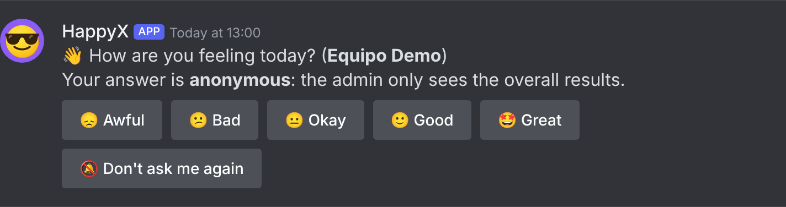
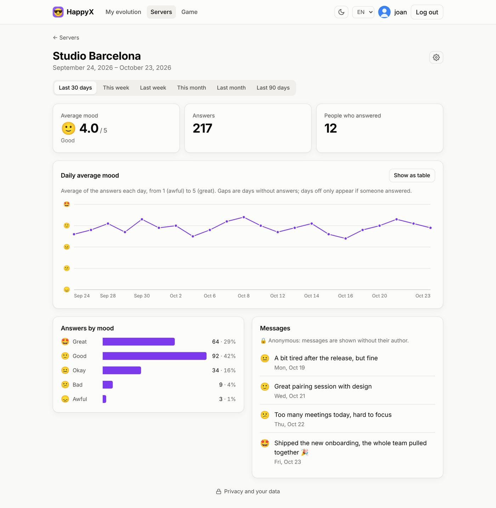
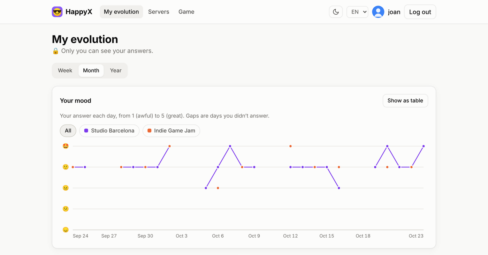
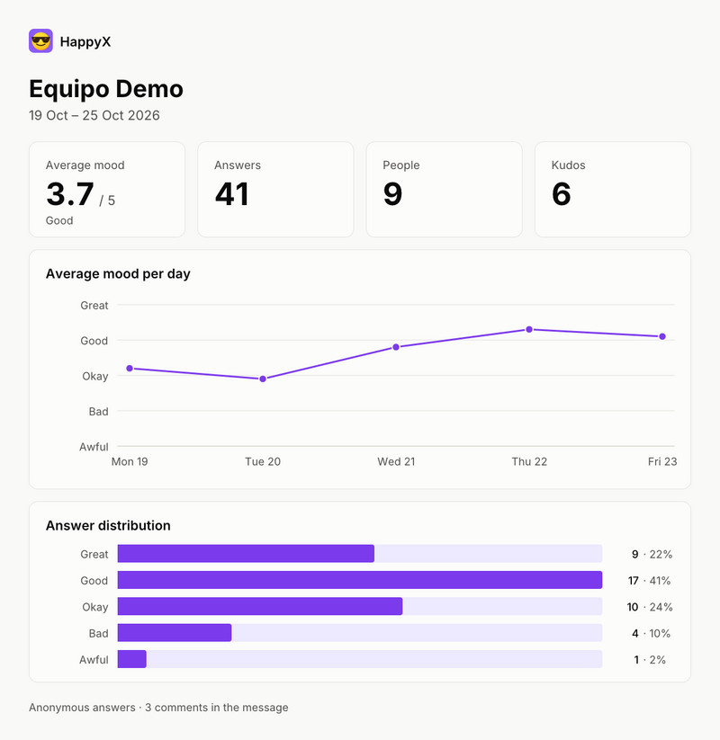
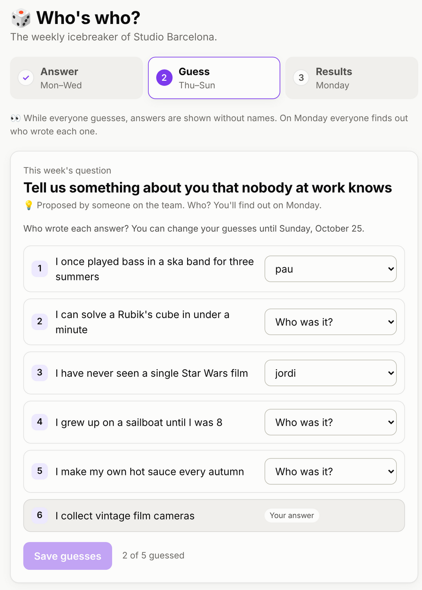
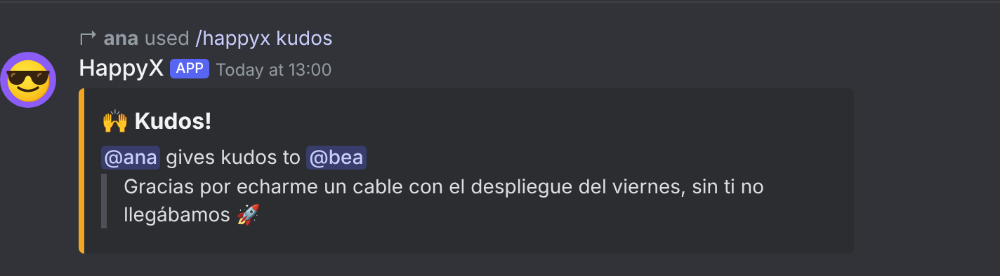
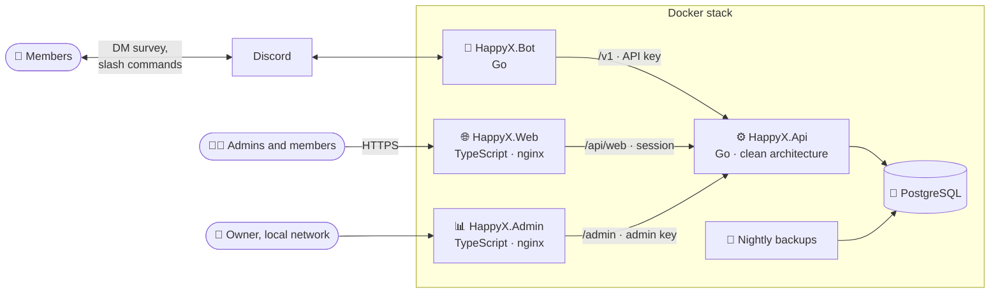

<div align="center">


# HappyX

**How is your Discord server really doing?**

A Discord bot that asks your team how they feel every working day, anonymously,
and turns the answers into reports and charts the admin can actually read.

[](#self-host)
[](https://github.com/happyx-app/HappyX.Bot)
[](https://github.com/happyx-app/HappyX.Api)
[](https://github.com/happyx-app/HappyX.Web)
[](deploy/stack.yml)
[](#self-host)

[Features](#features) ·
[Screenshots](#screenshots) ·
[Architecture](#architecture) ·
[Self-host](#self-host) ·
[Development](#run-it-locally)

<br>



</div>

<br>

## How it works

| 1. Add the bot | 2. Everyone gets a daily question | 3. The admin gets the report |
| --- | --- | --- |
| Invite HappyX to your server. It registers the server and its members, and keeps every server's data apart, so one bot serves as many servers as you like. | On working days each member (bots aside) gets a DM: pick a face from 😞 to 🤩, add a comment if they want. Anonymous by default. | Every week or month the admin gets an image with the average mood, the daily trend and how answers spread, plus a web dashboard with charts. |

<div align="center">

</div>

## Features

<table>
<tr>
<td width="33%" valign="top">

### 🕶️ Anonymous by default
Admins see results, not names, unless the server chooses otherwise. Answers given while
anonymous **stay anonymous** even if the server goes public later.

</td>
<td width="33%" valign="top">

### 🖼️ Image reports
A weekly or monthly summary by DM, readable at a glance, in the server's language. The DM can be
turned off, and `/happyx report` shows it on demand.

</td>
<td width="33%" valign="top">

### 📈 Web dashboard
Log in with Discord to see each server's charts and messages for any period, and **My
evolution**: your own mood across all your servers. Light and dark theme.

</td>
</tr>
<tr>
<td valign="top">

### 🙌 Kudos
`/happyx kudos @someone` thanks a teammate in public. They get a DM, and the reports count and
quote them.

</td>
<td valign="top">

### 🎲 «Who's who?»
A weekly icebreaker: everyone answers a question, then guesses on the web who wrote what. The
team proposes next week's question.

</td>
<td valign="top">

### ⚙️ Your rules
Working days, survey time and timezone, report frequency, language, and your own survey message
with variables like `{{user.name}}` or `{{user.streak}}`.

</td>
</tr>
<tr>
<td valign="top">

### 🎯 Role filters
Choose who gets the survey and who plays the game: everyone, everyone except some roles, or only
some roles.

</td>
<td valign="top">

### 🔑 Admins and permissions
One main admin receives the reports. Give other members or Discord roles **view** (reports) or
**manage** (also settings) access.

</td>
<td valign="top">

### 🔒 Privacy built in
One-click opt-out for members, GDPR export and erase of your own data, server export, and a
danger zone that deletes a server and all its data.

</td>
</tr>
<tr>
<td valign="top">

### 🏢 Many servers, no mixing
The Discord server is the tenant key in every query. The same person in two servers is two
separate histories.

</td>
<td valign="top">

### 🌍 Multilingual
The bot speaks English, Spanish, Catalan, German, French, Italian and Brazilian Portuguese; the
dashboard English and Spanish. Adding a language is one JSON file.

</td>
<td valign="top">

### 💾 Easy to run
Three small Docker images on GHCR (amd64 and arm64), one Compose file, and nightly Postgres
backups with rotation.

</td>
</tr>
</table>

## Screenshots

**Server dashboard.** Average mood, daily trend, answers by mood and the (anonymous) messages, for
any period.

<picture>
  <source media="(prefers-color-scheme: dark)" srcset="docs/images/report-dark.png">
  
</picture>

**My evolution.** Every member sees their own answers, one line per server. Nobody else does.



<table>
<tr>
<th width="50%">The report image the admin receives</th>
<th width="50%">«Who's who?» on the web</th>
</tr>
<tr>
<td valign="top"></td>
<td valign="top"></td>
</tr>
</table>

**Kudos in Discord.**



<sub>Screenshots use sample data.</sub>

## Architecture



Only the dashboard is public. The bot talks to Discord outbound, and the API stays on the stack's
internal network: nginx in HappyX.Web forwards `/api/web/*` to it, so the browser only ever talks
to one origin. HappyX.Admin is an owner-only dashboard for the local network: it shows counts
across all servers (never moods, messages or names) through a separate admin port of the API.

| Repository | What it is |
| --- | --- |
| **[HappyX](https://github.com/happyx-app/HappyX)** | This repo: docs, screenshots and the Compose files to run HappyX. No application code: Api, Bot, Web and Admin are git submodules |
| [HappyX.Api](https://github.com/happyx-app/HappyX.Api) | Go REST API on PostgreSQL. Multi-server isolation, anonymity rules, reports, game, GDPR |
| [HappyX.Bot](https://github.com/happyx-app/HappyX.Bot) | Go Discord bot: daily survey by DM, slash commands, report images, kudos, game DMs |
| [HappyX.Web](https://github.com/happyx-app/HappyX.Web) | TypeScript dashboard without a framework, built with Vite and served by nginx. Charts are plain SVG |
| [HappyX.Admin](https://github.com/happyx-app/HappyX.Admin) | Owner-only dashboard for the local network: servers, usage, deliveries, health and backups. Counts only |
| [HappyX.Bruno](https://github.com/happyx-app/HappyX.Bruno) | [Bruno](https://www.usebruno.com/) collection with every API call. A separate tool, not a submodule |

Each component's README goes into the details: the API's routes, anonymity rules and credentials,
the bot's commands and how to add a language, the dashboard's screens and who sees what.

## Self-host

### What you need

- A server with Docker Engine and Docker Compose v2 (amd64 or arm64). Portainer works too.
- A domain for the dashboard, with HTTPS from a reverse proxy (Caddy, nginx, Traefik…).
- A Discord application for the bot and the login (free).

The API, the bot and the dashboard come as images on GHCR, published on every merge to `main`
(`latest`, `sha-<commit>`) and on `v*` tags (`1.2.3`): `ghcr.io/happyx-app/happyx-api`,
`ghcr.io/happyx-app/happyx-bot` and `ghcr.io/happyx-app/happyx-web`. They are public, so no
registry login is needed. Postgres 18 and the backups come in the same stack, and the API creates
and migrates its tables by itself when it starts.

### Steps

1. **Create the Discord application** (see [Setting up the Discord application](https://github.com/happyx-app/HappyX.Bot#setting-up-the-discord-application)
   in HappyX.Bot). It needs the **Server Members** intent. Add
   `<WEB_URL>/api/web/auth/callback` to its OAuth2 redirects.
2. **Start the stack** with the [environment variables](#environment-variables) below.

   With Docker Compose:

   ```sh
   mkdir happyx && cd happyx
   curl -fsSLO https://raw.githubusercontent.com/happyx-app/HappyX/main/deploy/stack.yml
   # create .env with the variables below, one VAR=value per line
   docker compose -f stack.yml --env-file .env up -d
   ```

   With Portainer: **Stacks > Add stack > Repository**, this repo and the compose path
   `deploy/stack.yml`, and the variables under **Environment variables**.
3. **Put your HTTPS reverse proxy in front of the dashboard** (`WEB_PORT`, default 8084). Only the
   dashboard needs to be public; the API's port stays on `127.0.0.1`. With Caddy on the same
   server, for example:

   ```
   happyx.example.com {
       reverse_proxy 127.0.0.1:8084
   }
   ```

   The dashboard's nginx limits requests per visitor and trusts the proxy's `X-Forwarded-For`
   only when the proxy connects from a private or loopback address (10/8, 172.16/12, 192.168/16,
   127/8). A proxy on the same server or the same private network is fine; one reaching it from a
   public IP would make every visitor count as one.
4. **Optional: the admin dashboard** (`ADMIN_PORT`, default 8090) is for whoever runs the
   stack. Make a key just for it (as below, not one of `API_KEY_HASHES`), set `ADMIN_API_KEY` to
   the key and `ADMIN_KEY_HASH` to its hash, and open `http://<server>:8090` from your local
   network. Do not put it behind the public proxy: its nginx refuses non-private addresses anyway.
   Without the key it only shows how to set it up, and the API keeps its admin port closed.
5. **Add the bot to your server** with the **Add to Discord** button on the dashboard's landing
   page (or the URL Generator, as in the bot's README). The server's owner becomes its HappyX
   admin, who gets the reports; that can be changed later.
6. **Adjust the defaults** with `/happyx config` or the dashboard's settings. A new server starts
   anonymous, in English, with the survey Monday to Friday at 13:00 Europe/Madrid and a weekly
   report.

To update, run `docker compose -f stack.yml pull && docker compose -f stack.yml up -d`, or
**Pull and redeploy** in Portainer (with "Re-pull image" on). Set `HAPPYX_TAG` to pin a version.
Upgrading from an older stack? See [UPGRADING.md](UPGRADING.md).

### Environment variables

| Variable | Required | What it is |
| --- | :---: | --- |
| `POSTGRES_PASSWORD` | ✅ | Database password |
| `API_KEY_HASHES` | ✅ | SHA-256 hash(es) of the API keys, comma separated |
| `DISCORD_TOKEN` | ✅ | Discord bot token |
| `BOT_API_KEY` | ✅ | The bot's API key (its hash must be in `API_KEY_HASHES`) |
| `WEB_URL` | for login | Public URL of the dashboard, e.g. `https://happyx.example.com`. The bot also links to it for the «Who's who?» game |
| `DISCORD_CLIENT_ID` | for login | Discord application > OAuth2 > Client ID. Also enables the **Add to Discord** button |
| `DISCORD_CLIENT_SECRET` | for login | Discord application > OAuth2 > Client Secret |
| `SESSION_SECRET` | for login | Signs login sessions: `openssl rand -hex 32` |
| `ADMIN_API_KEY` | for admin | The admin dashboard's key, given to the admin container |
| `ADMIN_KEY_HASH` | for admin | SHA-256 hash of `ADMIN_API_KEY`. Opens the API's admin port; must differ from `API_KEY_HASHES` |
| `HAPPYX_TAG` | | Image tag to deploy (default `latest`; e.g. `1.0.0` or `sha-abc1234`) |
| `WEB_PORT` | | Host port for the dashboard (default 8084) |
| `ADMIN_PORT` | | Host port for the admin dashboard, local network only (default 8090) |
| `API_PORT` | | Host port for the API, bound to 127.0.0.1 only (default 8083) |
| `BACKUP_DIR` | | Host folder for backups (default: the `db_backups` volume; `chown -R 999:999` it). The API reads it, read only, to show the latest backups in the admin dashboard |
| `TZ` | | Timezone of the nightly backup schedule and file names (default `UTC`) |

To make an API key and its hash:

```sh
KEY=$(openssl rand -hex 32); echo "key:  $KEY"; echo -n "$KEY" | sha256sum
```

Give the key to the client (`BOT_API_KEY`) and put only the hash in `API_KEY_HASHES`. See
[HappyX.Api's README](https://github.com/happyx-app/HappyX.Api#credentials) for how API keys work.

### Backups

Every night the `backup` service dumps the database, keeping 7 daily, 4 weekly and 6 monthly
copies. To restore one (this replaces the current data):

```sh
docker exec -i <db container> psql -U happyx -d happyx -c 'DROP SCHEMA public CASCADE; CREATE SCHEMA public;'
gunzip -c <backup>.sql.gz | docker exec -i <db container> psql -U happyx -d happyx
```

## Run it locally

```sh
git clone --recurse-submodules https://github.com/happyx-app/HappyX
cd HappyX
git submodule update --remote   # move Api, Bot, Web and Admin to the latest main
cp .env.example .env   # fill in a password, the Discord token and the bot's API key + its hash
docker compose up -d --build
curl localhost:8083/health
```

The dashboard is at http://localhost:8084. To log in, fill the `DISCORD_CLIENT_*` and
`SESSION_SECRET` variables in `.env` (see the comments there) and add
`http://localhost:8084/api/web/auth/callback` to the Discord application's OAuth2 redirects.
The admin dashboard is at http://localhost:8090 once `ADMIN_API_KEY` and `ADMIN_KEY_HASH` are set.

Secrets live only in `.env`, which is git-ignored.

`docker-compose.yml` builds the images from the submodules, for development. To run HappyX
for real, use `deploy/stack.yml` as in [Self-host](#self-host).

Working on one piece? Each repo has its own development notes: `go test ./...` in the API and
the bot, `npm test` and `npm run dev` in the web and the admin dashboard, and `go run ./cmd/preview` in the bot renders
every message it sends as a Discord-styled page, no Discord server needed.

## Contributing

Ideas, bugs and pull requests are welcome. See [CONTRIBUTING.md](CONTRIBUTING.md) for which repo
each change goes in.

## License

[MIT](LICENSE), like every HappyX repository.

<br>

<div align="center">

<br>
<sub>Made with 💜 · <a href="#self-host">Host your own</a></sub>
</div>
